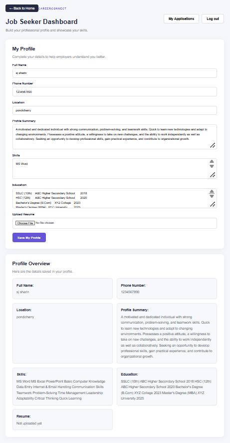

# CareerConnect – Job Portal & Smart Resume Management System

## About the Project

CareerConnect is a web-based job portal designed to connect job seekers with companies. It provides a platform for job seekers to explore job opportunities, manage applications, and maintain their resumes. Companies can register, manage their profiles, and post job vacancies after administrator verification.

## Technologies Used

### Frontend
- React.js
- Vite
- JavaScript
- HTML
- CSS

### Backend
- Python
- Django
- Django REST Framework
- JWT Authentication

### Database
- MySQL

## Project Structure

```text
CareerConnect/
├── backend/
│   ├── accounts/
│   ├── config/
│   ├── jobs/
│   ├── manage.py
│   ├── requirements.txt
│   └── .env.example
│
├── frontend/
│   ├── public/
│   ├── src/
│   ├── package.json
│   └── vite.config.js
│
├── .gitignore
└── README.md
```

## Setup Instructions

### 1. Clone the Repository

```bash
git clone https://github.com/Sjsharin/CareerConnect.git
cd CareerConnect
```

### 2. Backend Setup

Navigate to the backend folder:

```bash
cd backend
```

Create a Python virtual environment:

```bash
python -m venv venv
```

Activate the virtual environment on Windows:

```bash
venv\Scripts\activate
```

Install the required packages:

```bash
pip install -r requirements.txt
```

### 3. Environment Configuration

Create a `.env` file inside the `backend` folder using `.env.example` as a reference.

Configure your own local values:

- Django secret key
- Debug setting
- MySQL database name
- MySQL username
- MySQL password
- Database host
- Database port

Never upload your actual `.env` file to GitHub.

### 4. Database Setup

Make sure MySQL is installed and running.

Create the database named `job_portal_db` in MySQL, and configure the database credentials in your `.env` file.

Run database migrations:

```bash
python manage.py migrate
```

Start the Django development server:

```bash
python manage.py runserver
```

The backend will run at:

```text
http://127.0.0.1:8000/
```

### 5. Frontend Setup

Open another terminal and navigate to the frontend folder:

```bash
cd frontend
```

Install frontend dependencies:

```bash
npm install
```

Start the React development server:

```bash
npm run dev
```

## Security

- Never upload `.env` files.
- Never expose database passwords or Django secret keys.
- Keep authentication tokens secure.
- Configure your own environment variables before running the application.

## Project Status

Under development.
## Application Screenshots

### Login Page


### Job Seeker Dashboard


